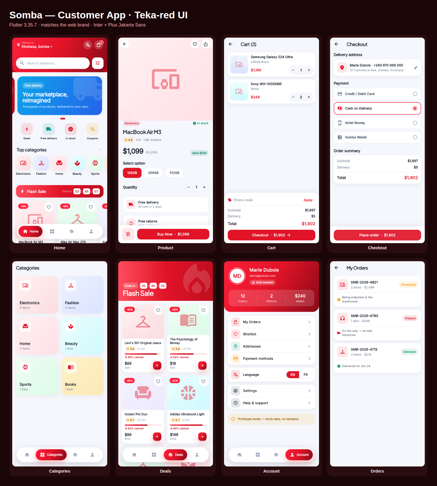

# Somba — Customer App (Flutter)

The customer-facing marketplace app for **Somba&Teka**, built with Flutter.

## Highlights

- Modern, top-tier e-commerce UI: gradient header, hero carousel, live flash-sale
  countdown, premium product cards, wishlist, variant & quantity selectors, a full
  cart → checkout → order-success flow, and a polished account area.
- Contemporary touches: **floating capsule navigation** with an animated expanding
  pill, **Plus Jakarta Sans** display headings paired with Inter body text, a "For You / Trending"
  feed selector, and "% claimed" urgency bars on deals.
- Centralised design system (`lib/theme/app_theme.dart`) — colour, type, radius,
  elevation and component themes in one place.
- Bundled **Inter + Plus Jakarta Sans** fonts (no runtime font fetching) and self-contained product
  visuals (gradient tiles with category glyphs) that fall back gracefully when
  network images are unavailable.
- English / French localisation.

## Run locally

```bash
cd mobile
flutter pub get
flutter run            # device / emulator
flutter run -d chrome  # web
```

Requires Flutter **3.35.7** or newer (verified with 3.47.6).

## Realtime backend connection

The **Live** tab connects to the NestJS backend (`../api`) over a single
authenticated **Socket.IO** connection. A one-shot REST call logs in; every read,
write, and live update then flows over the socket — no polling.

- Services live in `lib/services/` (`env.dart`, `auth_service.dart`,
  `socket_service.dart`, `realtime_store.dart`).
- Configure the endpoint at run time (no `.env` file in Flutter — use
  `--dart-define`):

```bash
# Android emulator (default): host is reachable at 10.0.2.2
flutter run
# iOS simulator / desktop:
flutter run --dart-define=API_URL=http://localhost:3001 \
            --dart-define=SOCKET_URL=http://localhost:3001
# physical device on your LAN:
flutter run --dart-define=API_URL=http://192.168.1.20:3001 \
            --dart-define=SOCKET_URL=http://192.168.1.20:3001
```

Demo login: `customer@somba.app` / `Somba@2026` (see `../api/README.md`). Place an
order on the Live tab and watch it appear instantly on the web admin console
(`/live`) — same backend, same live state.

## CI/CD — Android APK

`.github/workflows/customer-app-apk.yml` builds the release APK on every push that
touches `mobile/`:

1. Sets up JDK 17 + Flutter 3.35.7
2. `flutter pub get` → `flutter analyze` → `flutter test`
3. `flutter build apk --release` (universal) and `--split-per-abi`
4. Uploads the APKs as a workflow artifact (`somba-customer-apk`)
5. Publishes a GitHub Release with `somba-customer.apk` attached

Download the latest APK from the repository **Releases** page or from the workflow
run's **Artifacts**.

## Screenshots

Rendered from the web build. See [`docs/screenshots/`](docs/screenshots).



## Project layout

```
lib/
  theme/app_theme.dart     # design system
  util/format.dart         # currency / number formatting
  widgets/                 # product card, product image, shared UI (badges, countdown…)
  screens/                 # home, categories, deals, product detail, cart, checkout,
                           # order success, orders, account
  data/                    # live catalogue models, cart/shop state (server-priced), market profiles
  l10n/strings.dart        # EN/FR strings
```

## Live backend, tests

Everything (catalogue, prices, stock, orders, wallet, addresses, wishlist, promos, notifications) comes
from the API over one authenticated Socket.IO connection; there is no guest checkout and no demo
login (seeded dev account: `customer@somba.app` / `Somba@2026`, dev only). Mobile-money orders stay
**pending** until the provider confirms (push), and server rule errors are shown as readable messages.

```bash
flutter analyze && flutter test                      # widget tests
flutter test test/live_api_test.dart --dart-define=LIVE_TEST=true \
  --dart-define=API_URL=http://localhost:3001 --dart-define=SOCKET_URL=http://localhost:3001
```


## Languages (French / English)

French is the default (the market is DR Congo); the language can be switched on the sign-in screens and in *Account*, is remembered on the device and, once signed in, saved on the account (`me:update {locale}`).

* All texts are in `lib/l10n/messages.dart` as `key → (English, French)`; screens read them as `Strings.of(context).someKey` (typed accessors in `lib/l10n/strings_keys.dart`, same keys). `Strings.current` is the language for code without a `BuildContext`.
* Amounts and dates follow the language (`3 417 150 FC` / `FC 3,417,150`, `17 oct. 2026` / `Oct 17, 2026`), via `intl`.
* Server messages arrive in English: `lib/l10n/server_errors.dart` maps the known ones (invalid credentials, out of stock, insufficient wallet balance, order not found, not allowed, …) and shows any other message as received. Server notifications and wallet history lines are translated in `lib/l10n/notification_text.dart`.
* To add a text: add the key with both languages to `messages.dart` and the one-line accessor to `strings_keys.dart`. `test/l10n_test.dart` fails if a language is missing or empty, if the French equals the English, if a `{placeholder}` differs, or if a screen hard-codes visible text.

## Push notifications

`lib/services/push_service.dart` registers the device with the API after sign-in when the build contains the Firebase configuration, and does nothing otherwise. See `../docs/MOBILE-PUSH.md` for the manual steps with the client's Firebase project.
