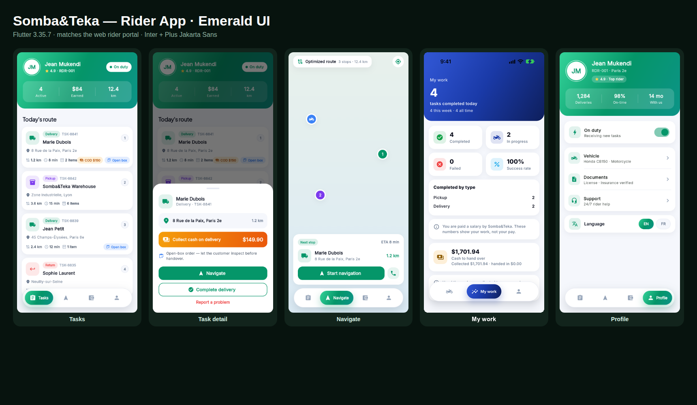

# KOMORIKO — Rider App (Flutter)

The rider/courier app for the KOMORIKO marketplace: work through the tasks your warehouse
assigns (pickups, transfers, deliveries, returns, replacements), open turn-by-turn navigation in
your maps app, and see what you completed. Customers always pay up front, so there is nothing for a rider to collect. Riders are salaried: the app
has no payout or withdrawal.

## Realtime backend connection

The whole app runs on live data (no mock tasks): it connects to the NestJS backend (`../api`) over a single
authenticated **Socket.IO** connection (services in `lib/services/`). The rider's warehouse
assigns the tasks (pickup, transfer, delivery, returns, replacements; there is no self-accept); the rider
advances each leg's status and streams GPS — each action pushes live to the customer app and the web dashboards.

Configure the endpoint with `--dart-define` (defaults target the Android
emulator loopback `10.0.2.2`). `API_URL` is enough: the socket follows it, and
`SOCKET_URL` is only for a socket hosted elsewhere:

```bash
flutter run --dart-define=API_URL=http://localhost:3001
```

Seeded dev login (`npm run seed` in `api/` only): `rider@somba.app` / `Somba@2026`. Production riders
are created by the fleet team in the admin panel. The sign-in screen never pre-fills credentials and
never lets anyone in offline.

Tabs: **Deliveries** (Active / Done; picked up → in transit → delivered, with the customer's code on deliveries; legs that end at a warehouse are scanned in by its staff;
Done can be searched by order reference and narrowed to a range of days),
**My work** (server-computed work stats: tasks completed today / this week / all time, success rate, completed by type), **Profile** (edit name and phone,
change password, home warehouse, **Support** tickets with photos, notifications, language, sign out). While a delivery is on the road the app streams the
real GPS position (`geolocator`; permission declared in the Android manifest) as `delivery:location`.

### Tests

```bash
flutter analyze && flutter test                      # widget tests
# live end-to-end against a seeded, running API (sign in, warehouse assigns a pickup, support ticket round trip):
flutter test test/live_api_test.dart --dart-define=LIVE_TEST=true \
  --dart-define=API_URL=http://localhost:3001 --dart-define=SOCKET_URL=http://localhost:3001
```

## How the rider works (and what the app does not have)

- **The warehouse assigns every task.** There is no pool of open jobs, no accept and no refuse: a task shows up
  in *Active* (with a "New task assigned to you" notice) as soon as the warehouse desk assigns it, and the rider
  only moves it along: picked up → on the way → delivered (or failed, with a reason). The server refuses
  `delivery:accept` for riders ("Your warehouse assigns your tasks...") and `delivery:unassigned` is empty for them.
- **No on-duty switch.** The green **Online** pill on the Deliveries header only shows that the phone is connected
  to the server (`ConnStatus`); it does not make the rider available or unavailable. A rider receives work as long
  as the account is active; to stop work, the desk stops assigning or an admin switches the account off (the app then
  signs the rider out).
- **No pay per task.** Riders are salaried. *My work* shows their work (tasks done, failed, success rate), never money
  earned. Nothing is paid out or withdrawn through the platform.

## Highlights

- Royal-blue identity with a **floating capsule navigation** (animated expanding pill), **Plus Jakarta Sans** display
  headings paired with Inter body text. Bundled fonts: no runtime font fetching.
- **Deliveries**: Active / Done tabs, task cards for every leg (pickup, transfer, delivery, return, replacement) with
  the parcel, from → to, and the next action as a label-only button; transfer runs are one card with the parcels
  inside. *Done* has a search by order reference (or run reference) and a date-range filter.
- **Navigate**: opens turn-by-turn directions in your maps app. Android: Google Maps (the app when installed, else the
  browser). iPhone: **Apple Maps** straight away when Google Maps is not installed (no extra tap); when both are installed a
  small list asks which one to use for this trip. No API key is needed for Navigate.
- **Route map**: a "Route map" button on every active card (and transfer run) opens the rider, the next stop (the one
  Navigate leads to) and the route line on a Google map. Needs the Maps key (see *Maps key* below); without it the button is
  not offered and Navigate is all there is. With *Routes API* enabled on the key the line follows the roads, with the
  distance and time; otherwise it is a dashed straight line, and says so.
- **My work**: tasks completed today, this week and all time; completed, in progress, failed and success rate; completed by
  type (counts only).
- **Profile**: edit name and phone, change password (the server signs every other phone out and this phone keeps working),
  home warehouse and the areas it covers, support tickets, notifications, EN/FR toggle, sign out. The e-mail, role and
  warehouse are changed by the fleet team or an admin only.
- **Session**: if the server revokes the session (password changed elsewhere, account switched off), the rider is signed out
  cleanly: every screen opened on top is closed and the sign-in screen shows with a message.

## Run locally

```bash
cd rider-app
flutter pub get
flutter run            # device / emulator
flutter run -d chrome  # web
```

Requires Flutter **3.35.7** or newer (verified with 3.47.6).

## CI/CD — Android APK

`.github/workflows/rider-app-apk.yml` builds the release APK on every push that
touches `rider-app/`:

1. JDK 17 + Flutter 3.35.7
2. `flutter pub get` → `flutter analyze` → `flutter test`
3. `flutter build apk --release` (universal) and `--split-per-abi`
4. Uploads the APKs as the `komoriko-rider-apk` artifact
5. Publishes a GitHub Release with `komoriko-rider.apk` attached

## Install the test APK

The CI build of this app talks to the **live test server** (`https://komoriko.com`), so a client can install it and try it.

1. **Download.** Open the repository **Releases** page and take `komoriko-rider.apk` from the latest `rider-apk-v<N>` release, or open the **Actions** tab, pick the latest "Rider App · Build APK" run and download the `komoriko-rider-apk` artifact (a zip containing `komoriko-rider.apk` and the per-ABI APKs). Use `komoriko-rider.apk` (universal) unless you know the phone's ABI.
2. **Allow the install.** On the phone: Settings, then Security (or "Install unknown apps"), then allow your browser or file manager to install unknown apps. Open the APK and confirm.
3. **Server.** The APK was built with `API_URL` set to the server named in the release notes and in the run summary ("Talks to: ..."). The Socket.IO realtime connection uses the same host. Plain HTTP is allowed on Android only for `107.170.116.169` (`android/app/src/main/res/xml/network_security_config.xml`, release builds included); any other host must be HTTPS. To point a build elsewhere, run the workflow by hand (Actions, "Run workflow") and fill in **api_url**, or set the repo variable `LIVE_API_URL`; if the new host is plain HTTP, add it to the network security config first.
4. **Sign in.** Sign in with the demo **rider** account (e-mail ends in `@demo.komoriko.test`; the rider is created by the demo seed). Accounts and where their passwords are kept: `deploy/DEMO-SEED.md` (the demo data must be installed on the server). Do not share passwords in the repository or in tickets.
5. **Upgrading.** If a debug-signed APK is installed (an earlier CI build, or `flutter run`), uninstall it before installing a release-signed one: Android refuses to update an app signed with a different key. The same applies the other way round. Signing: `docs/ANDROID-RELEASE-SIGNING.md`.

### Repo variables and secrets the APK workflow reads

| Name | Kind | Becomes | Needed |
|---|---|---|---|
| `LIVE_API_URL` | variable | `--dart-define=API_URL` (base URL, no `/api/v1`; the **api_url** run input wins) | optional, default `https://komoriko.com` |
| `LIVE_SOCKET_URL` | variable | `--dart-define=SOCKET_URL` | optional, only if Socket.IO is on another host |
| `GOOGLE_MAPS_API_KEY` | secret | `--dart-define=GOOGLE_MAPS_API_KEY` and the Android manifest placeholder of the same name | optional, map off without it |
| `FIREBASE_API_KEY`, `FIREBASE_PROJECT_ID`, `FIREBASE_SENDER_ID`, `FIREBASE_ANDROID_APP_ID` | secrets | `--dart-define` with the same names | optional, all four for push |
| `ANDROID_KEYSTORE_BASE64`, `ANDROID_KEYSTORE_PASSWORD`, `ANDROID_KEY_ALIAS`, `ANDROID_KEY_PASSWORD` | secrets | release signing | optional, debug-signed without them |

```bash
gh variable set LIVE_API_URL --body "http://<server-ip-or-domain>"
gh secret set GOOGLE_MAPS_API_KEY --body "<maps-key>"
gh secret set FIREBASE_API_KEY --body "<value>"   # likewise FIREBASE_PROJECT_ID, FIREBASE_SENDER_ID, FIREBASE_ANDROID_APP_ID
```

Secrets are not available to pull requests from forks; those builds have no Maps or Firebase key.

## Screenshots

Rendered from the web build. See [`docs/screenshots/`](docs/screenshots).




## Languages (French / English)

The first launch follows the phone (`fr` → French, anything else → English); the choice made on the sign-in screen or in *Profile* is remembered (`shared_preferences`). Texts are in `lib/l10n/messages.dart` (`key → (English, French)`, typed accessors in `strings_keys.dart`, `Strings.of(context)`), server messages are mapped in `lib/l10n/server_errors.dart`. `test/l10n_test.dart` checks that every text exists in both languages and that no screen hard-codes visible text.

## Position sharing while a delivery is in transit (background)

The GPS runs **only while a delivery is `in_transit`**; it stops when the delivery is delivered or failed, and on sign-out (`RiderStore._syncLocation`).

* Android: geolocator's foreground service (`ForegroundNotificationConfig`, ongoing notification "Livraison en cours / Delivery in progress" in the rider's language). Manifest: `FOREGROUND_SERVICE`, `FOREGROUND_SERVICE_LOCATION`, `WAKE_LOCK`, `POST_NOTIFICATIONS` (the service type `location` is declared by geolocator). Only the *while in use* location permission is needed because the service is started from the foreground; the app label is localised in `res/values{,-fr}/strings.xml`.
* iOS (`ios/` project, generated with `flutter create --platforms=ios`): `UIBackgroundModes` = `location` + `remote-notification`, `AppleSettings(allowBackgroundLocationUpdates: true, showBackgroundLocationIndicator: true, pauseLocationUpdatesAutomatically: false)`, and the usage descriptions in `Info.plist` with French/English `InfoPlist.strings` (`en.lproj`, `fr.lproj`, registered in the Xcode project). Before the first ride a full screen explains why the position is shared (`lib/screens/location_access_screen.dart`); when location is refused or off it offers **Open settings** and carries on by itself when the rider comes back.
* **`ACCESS_BACKGROUND_LOCATION` and iOS "Always" are not requested**: see `docs/BACKGROUND-LOCATION.md` for the decision and how it was checked.
* **Checked on an Android 14 emulator and an iOS simulator with scripted positions** (`integration_test/ride_device_test.dart`, `simctl location`, `adb emu geo fix`): positions kept arriving with the app in the background and, on Android, with the screen off. **Not yet tried on a real Android phone or a real iPhone**: check battery behaviour and vendor battery savers before release.

## Maps key (route map)

Same wiring as the customer app, three places (all git-ignored, never committed):

* Android: `GOOGLE_MAPS_API_KEY=...` in `android/local.properties` (read in `android/app/build.gradle.kts`) or `-PGOOGLE_MAPS_API_KEY=...`;
* iOS: `GOOGLE_MAPS_API_KEY=...` in `ios/Flutter/Secrets.xcconfig` (`Info.plist` `GMSApiKey`, started in `AppDelegate.swift`);
* Dart: `--dart-define=GOOGLE_MAPS_API_KEY=...` (turns the map on and is the key for the Routes API call).

Enable *Maps SDK for Android* and *Maps SDK for iOS* for the key; add *Routes API* for road-following lines. The Firebase files
(`android/app/google-services.json`, `ios/Runner/GoogleService-Info.plist`) are git-ignored too.

## Push notifications

Same `PushService` as the customer app (`app: 'rider'`); see `../docs/MOBILE-PUSH.md`.
